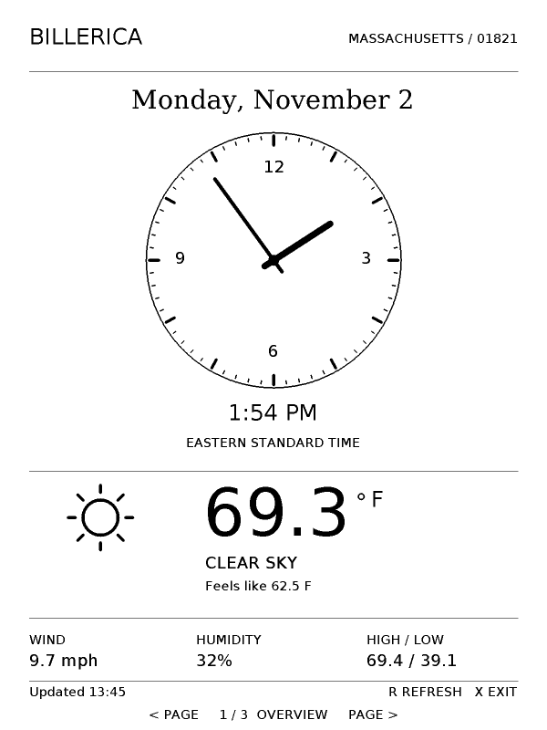
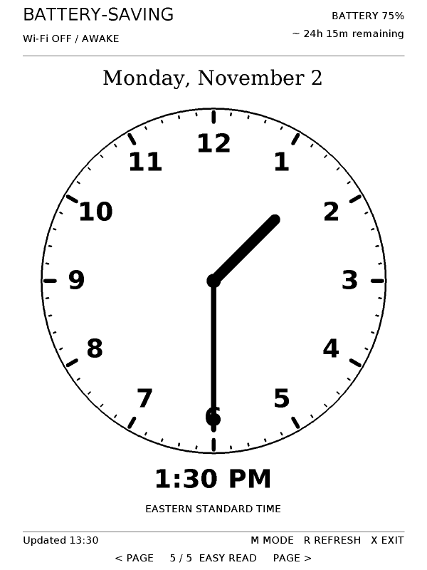
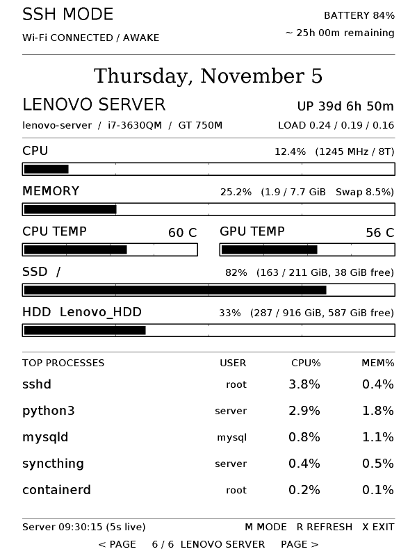

# Kindle Dashboard (`kindle-dashboard`)

A freestanding, zero-libc native ARMv6 weather clock and live home-server telemetry dashboard for the **600×800 Kindle Keyboard (Kindle 3)**.

Built directly against the Linux kernel syscall interface (`-ffreestanding -nostdlib -static`), the application renders 2× supersampled (`1200×1600`) vector geometry and embedded DejaVu typography downsampled into smooth 4-bit grayscale on the e-ink framebuffer (`/dev/fb0`).

Standalone **Calculator** and six-page **Weather Dashboard** Kindlets can also
open directly from Home. See [Kindlet build, test and deployment instructions](kindlets/README.md).

---

## Six Views & Hardware Controls

Use either side's **Next Page** (`104` / `191`) or **Previous Page** (`109` / `193`) hardware buttons to cycle through the six views:

1. **Overview (`Page 1 / 6`)**: Analog clock dial, digital time, current temperature, weather condition icon, feels-like temperature, wind speed, humidity, and daily high/low.
2. **Clock (`Page 2 / 6`)**: Large analog clock dial with a compact digital time and current weather summary.
3. **Forecast (`Page 3 / 6`)**: Current weather details plus the next two days' highs, lows, conditions, precipitation probability, and maximum wind speeds.
4. **Daily Quote (`Page 4 / 6`)**: 31 offline daily motivational quotes, word-wrapped in 28pt serif and rotating automatically at midnight US Eastern time.
5. **Easy Read (`Page 5 / 6`)**: Full-screen high-contrast monitor dial with all twelve bold Arabic numerals, distinct thick hour and slim minute hands, and bold digital time readout.
6. **Lenovo Server Dashboard (`Page 6 / 6`)**: Real-time hardware and process telemetry dashboard for a home Linux server (`/api/specs`), featuring 2× supersampled gauge bars (with 25%/50%/75% scale ticks) for:
   - **CPU Usage**, average clock frequency (MHz), and thread count
   - **Memory (RAM)** usage (GiB used/total) and **Swap** percentage
   - **CPU & GPU Temperatures** (`°C`) side by side
   - **Storage Mounts** (`SSD /` and secondary `HDD` capacity, used GiB, and free GiB)
   - **Top Processes** table (`Process`, `User`, `CPU%`, `MEM%`)

### Keyboard Shortcuts

- **`< Page` / `Page >`**: Cycle backward / forward through the 6 views
- **`R`**: Trigger an immediate refresh (weather on Pages 1–5, server telemetry on Page 6)
- **`M`**: Toggle between **Battery-Saving Mode** (Wi-Fi off between updates, RTC suspend enabled) and **SSH Maintenance Mode** (Wi-Fi stays connected, sleep paused)
- **`X` / `Home` / `Back`**: Cleanly exit the dashboard, restore the user's previous Wi-Fi setting, and resume the stock Kindle UI

---

## Previews

| Overview (`1/6`) | Easy Read (`5/6`) | Server Dashboard (`6/6`) |
| :---: | :---: | :---: |
|  |  |  |

---

## Power Management & Smart Polling

- **Pages 1–5 (Weather, Clock & Quote Views)**:
  - Fetches 3-day forecasts directly from [Open-Meteo](https://open-meteo.com/) over verified HTTPS once per hour (using a bundled static ARMv5 musl `curl` to support modern TLS on the Kindle's 2.6.26 kernel).
  - Never polls the home server while Pages 1–5 are active.
  - Automatically disables Wi-Fi after each fetch and suspends the CPU to RAM (`/sys/power/state`) using the `mxc_rtc.0` hardware alarm until the next minute tick, 5-minute battery sample, or hourly weather update.
- **Page 6 (Live Server Dashboard)**:
  - While Page 6 is active, keeps the Kindle awake with Wi-Fi connected and polls the LAN server endpoint (`/api/specs`) **every 5 seconds** (`Server HH:MM:SS (5s live)`).
  - Uses fast non-flashing e-ink updates for the 5-second ticks (performing a full e-ink refresh only on page entry and once every 60 updates / 5 minutes).
  - As soon as you navigate away from Page 6 in Battery-Saving mode, server polling stops and Wi-Fi is automatically turned off so deep RTC sleep resumes.

---

## Project Structure

- `src/start.S` — Minimal ARMv6 `_start` assembly entrypoint
- `src/app.c` — 2× supersampled rasterizer, 6-page UI renderer, input/RTC event loop, and framebuffer ioctl driver
- `src/weather.h` — Bounded recursive-descent JSON parser, Open-Meteo extractor, and US/Eastern DST calendar math
- `src/server.h` — Server telemetry JSON parser (`read_server`) and 64-bit bit-shift GiB formatters
- `src/navigation.h` — 6-page cyclic keypad mapping
- `src/battery.h` — `yoshi_battery` current/capacity parser and runtime estimator
- `src/power.h` — RTC sleep duration scheduler
- `src/quotes.h` — Offline daily quote collection
- `src/ui-assets.h` & `make-ui-assets.py` — Embedded 2× DejaVu glyph bitmaps and fixed-point sine table generator
- `package/extensions/weather-clock/` — KUAL extension package (`launch.sh`, `fetch.sh`, `battery.sh`, `config.xml`, `menu.json`)
- `test_weather.py` — Host `ctypes` + `qemu-arm` test suite (13,960 DST/time transition checks, JSON validation, and 6-page framebuffer verification)

---

## Building, Testing & Deploying

### Build the ARMv6 Binary
Requires `arm-none-eabi-gcc` (either in system `PATH` or unpacked in `.tools/usr/bin`):
```sh
./dev.sh sh build.sh
```

### Run the Test Suite
Requires Python 3, host `cc`, and `qemu-arm`:
```sh
./dev.sh python3 test_weather.py
```

### Regenerate Font & Geometry Assets (Optional)
Requires Python 3 with Pillow (`PIL`) and DejaVu fonts installed on the host:
```sh
./dev.sh python3 make-ui-assets.py
```

### Deploy to Kindle Keyboard over SSH
Exit the running app on the Kindle (`X`), then run:
```sh
sh deploy.sh root@<kindle-ip>
```
